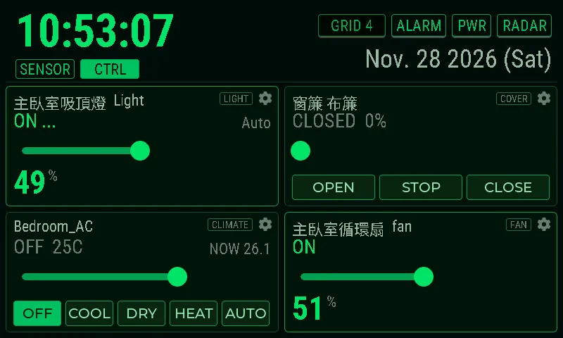
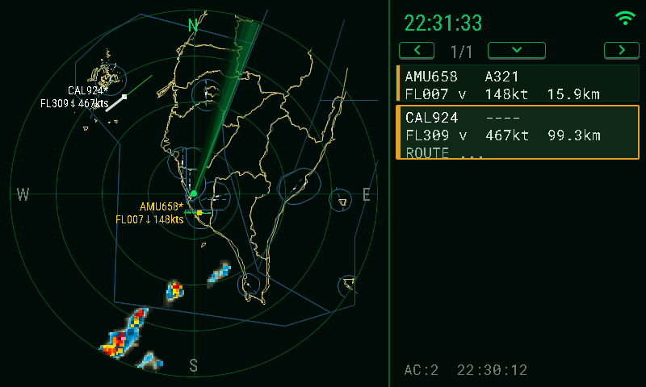
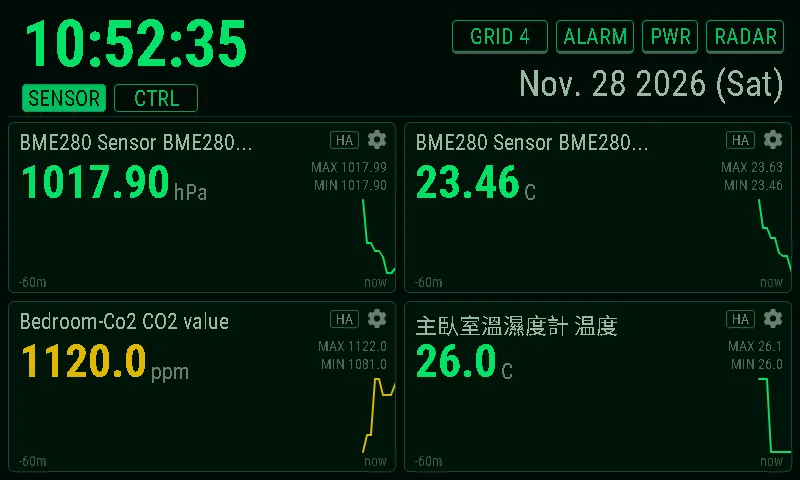
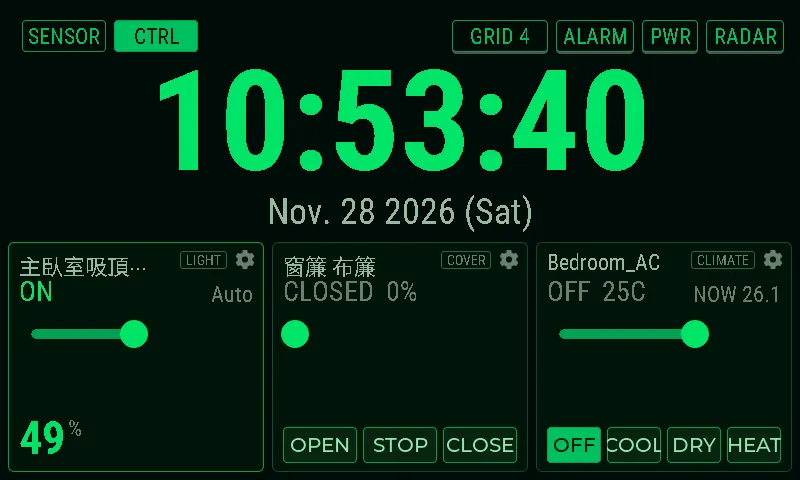

# ✈️ ESP32 Flight Radar

A desktop flight radar built entirely with **ESPHome**: live aircraft over your home on an
ATC-style scope, plus weather radar, a clock with sensor curves, Home Assistant controls and an alarm.

以 **ESPHome** 打造的桌面航班雷達:航管風格顯示你上空的即時航班,兼具氣象雷達、感測器時鐘、
Home Assistant 控制面板與鬧鐘。

以 **ESPHome** 打造的桌面航班雷达:航管风格显示你上空的实时航班,兼具气象雷达、传感器时钟、
Home Assistant 控制面板与闹钟。

**[English](#english) · [繁體中文](#繁體中文) · [简体中文](#简体中文)**


| 🆕 Home Assistant control / 裝置控制 | Flight strips / 航班列表 |
|---|---|
|  |  |
| **Sensor page / 感測器頁** | **🆕 Large clock / 大時鐘** |
|  |  |

▶ **[Demo video / 示範影片 / 示范影片](docs/demo.mp4)** · Inspired by [AnthonySturdy/micro-radar](https://github.com/AnthonySturdy/micro-radar)

---

## Boards / 支援板子 / 支持板子

| Entry | Board | Panel | Branch |
|-------|-------|-------|--------|
| `radar.yaml` | generic ESP32-S3 5" (esp32-s3-5inch-rgb-001) | 800×480 RGB | `main` |
| `radar-jc8048w550.yaml` | Guition JC8048W550**C** = Sunton ESP32-8048S050 | 800×480 RGB | `main` |
| `radar-panda-touch.yaml` | BIGTREETECH Panda Touch | 800×480 RGB | `main` |
| `radar-s3-5.yaml` | Waveshare ESP32-S3-Touch-LCD-5 | 800×480 RGB | `main` |
| `radar-s3-5b.yaml` | Waveshare ESP32-S3-Touch-LCD-5B | 1024×600 RGB | `main` |
| `radar-s3-7.yaml` | Waveshare ESP32-S3-Touch-LCD-7 | 800×480 RGB | `main` |
| `radar-s3-7b.yaml` | Waveshare ESP32-S3-Touch-LCD-7B | 1024×600 RGB | `main` |
| `radar-p4-7b.yaml` | Waveshare ESP32-P4-WIFI6-Touch-LCD-7B | 1024×600 MIPI-DSI | `lvgl9` |

All need **≥8 MB octal PSRAM**, a **GT911** touch controller and **16 MB flash**.
`main` (S3, ESPHome 2026.3 / LVGL 8) and `lvgl9` (P4, ESPHome 2026.6 / LVGL 9) are both maintained.

---

## English

### What it does

- **Live flight radar** — up to 40 aircraft from adsb.lol, airplanes.live or OpenSky. 🆕 The sweep
  looks like a radar CRT: coastlines and range rings glow as it passes; one turn every 12 s (4.8 / 6 s selectable).
- **Tap an aircraft** for route, squawk, altitude, speed and type; tap the type for a to-scale
  silhouette and specs from an offline database.
- **ATC mode and flight strips** — velocity vectors, trails, conflict alert; tap **▲** in the
  right panel for a strip list sorted by distance that draws the selected flight's full track.
- **Weather and map** — RainViewer rain echo; coastlines, airports, runways and airspace for your own location.
- **Clock page** (tap the clock) — up to 6 sensor cards with 24-hour curves: local weather,
  I²C sensors detected at boot (AHT20, SHT3x/4x, BME280, SCD4x) or any Home Assistant sensor.
  🆕 Tap the time for a large clock.
- 🆕 **Home Assistant control** — switch the cards to **CTRL** (button or swipe) to run lights
  (brightness, color temperature, modes), curtains, air conditioners and fans with sliders and buttons.
- **Alarm clock** — 4 alarms, rung through a Home Assistant speaker (or the P4's own).
- **Set up on the touch screen**, auto-discovered by Home Assistant, **OTA** after the first flash.

### Install

**[Flash from your browser](https://delphicchen.github.io/esp32_flight_radar/install.html)**
(Chrome or Edge). The first flash is over USB; if it stalls, hold **BOOT**, tap **RESET**, release **BOOT**.

From source:

```bash
git clone https://github.com/delphicchen/esp32_flight_radar && cd esp32_flight_radar
pip install 'esphome==2026.3.*'                          # P4: git checkout lvgl9, esphome==2026.6.*
tools/dev_flash.sh radar.yaml --device /dev/ttyACM0      # first flash over USB, then without --device
```

Use `tools/dev_flash.sh`, not a bare `esphome run`: all entries share one device name, and a bare
run can flash another board's stale image. Coming from v1.2.0 or older, flash once over USB
(the partition table changed).

### First run

1. Join the **`Radar-Setup`** hotspot (password `12345678`) and pick your Wi-Fi.
2. Tap the coordinates line to set your latitude, longitude and range. Aircraft appear within a minute.
3. For Home Assistant sensors, controls or alarm speakers, enter *HA URL* and *HA Token* in the device's web UI.

**More:** [Usage guide](docs/USAGE.md) · [Boards & internals](docs/BOARDS.md) · [Changelog](CHANGELOG.md)

---

## 繁體中文

### 它能做什麼

- **即時航班雷達** —— 從 adsb.lol、airplanes.live 或 OpenSky 取得最多 40 架航班。🆕 掃描線仿雷達 CRT:
  掃過時海岸線與距離環亮起再暗回去;預設 12 秒一圈(可改 4.8 / 6 秒)。
- **點選航班**看起訖、squawk、高度、速度與機型;點機型看等比例輪廓與規格(離線資料庫)。
- **ATC 模式與 flight strip** —— 速度向量、歷史軌跡、衝突警示;點右欄的 **▲** 打開依距離排序的 strip 列表,
  選中航班畫出完整航跡。
- **氣象與地圖** —— RainViewer 雨區回波;依你的座標下載海岸線、機場、跑道與空域。
- **時鐘頁**(點時鐘)—— 最多 6 張感測器卡片與 24 小時曲線:在地天氣、開機自動偵測的 I²C 感測器
  (AHT20、SHT3x/4x、BME280、SCD4x)或任何 Home Assistant 感測器。🆕 點時間切換大時鐘。
- 🆕 **Home Assistant 裝置控制** —— 卡片切到 **CTRL**(按鈕或左右滑動),用滑桿與按鈕控制燈光
  (亮度、色溫、模式)、窗簾、冷氣與風扇。
- **鬧鐘** —— 4 組,透過 Home Assistant 喇叭(或 P4 板載喇叭)響鈴。
- **全部在觸控螢幕上設定**,Home Assistant 自動探索,首次燒錄後即可 **OTA**。

### 安裝

**[用瀏覽器燒錄](https://delphicchen.github.io/esp32_flight_radar/install.html)**(Chrome 或 Edge)。
第一次要接 USB;卡住時按住 **BOOT**、點一下 **RESET**、再放開 **BOOT**。

從原始碼:見上方 [English → Install](#install) 的指令。請用 `tools/dev_flash.sh` 燒錄,不要直接
`esphome run`(所有入口共用同一個裝置名稱,可能燒到別塊板子的舊映像)。從 v1.2.0 以前升級要接 USB 燒一次(分割表換了)。

### 首次啟動

1. 連上 **`Radar-Setup`** 熱點(密碼 `12345678`)並選擇你的 Wi-Fi。
2. 點座標列設定經緯度與範圍,一分鐘內就會出現航班。
3. 要用 Home Assistant 感測器、裝置控制或鬧鐘喇叭,在裝置網頁填入 *HA URL* 與 *HA Token*。

**更多:** [使用說明](docs/USAGE.md) · [板子與內部細節](docs/BOARDS.md) · [更新紀錄](CHANGELOG.md)

---

## 简体中文

### 它能做什么

- **实时航班雷达** —— 从 adsb.lol、airplanes.live 或 OpenSky 获取最多 40 架航班。🆕 扫描线仿雷达 CRT:
  扫过时海岸线与距离环亮起再暗回去;默认 12 秒一圈(可改 4.8 / 6 秒)。
- **点选航班**看起讫、squawk、高度、速度与机型;点机型看等比例轮廓与规格(离线数据库)。
- **ATC 模式与 flight strip** —— 速度矢量、历史轨迹、冲突警示;点右栏的 **▲** 打开按距离排序的 strip 列表,
  选中航班画出完整航迹。
- **气象与地图** —— RainViewer 雨区回波;按你的坐标下载海岸线、机场、跑道与空域。
- **时钟页**(点时钟)—— 最多 6 张传感器卡片与 24 小时曲线:本地天气、开机自动检测的 I²C 传感器
  (AHT20、SHT3x/4x、BME280、SCD4x)或任何 Home Assistant 传感器。🆕 点时间切换大时钟。
- 🆕 **Home Assistant 设备控制** —— 卡片切到 **CTRL**(按钮或左右滑动),用滑杆与按钮控制灯光
  (亮度、色温、模式)、窗帘、空调与风扇。
- **闹钟** —— 4 组,通过 Home Assistant 音箱(或 P4 板载喇叭)响铃。
- **全部在触摸屏上设置**,Home Assistant 自动发现,首次烧录后即可 **OTA**。

### 安装

**[用浏览器烧录](https://delphicchen.github.io/esp32_flight_radar/install.html)**(Chrome 或 Edge)。
第一次要接 USB;卡住时按住 **BOOT**、点一下 **RESET**、再松开 **BOOT**。

从源码:见上方 [English → Install](#install) 的命令。请用 `tools/dev_flash.sh` 烧录,不要直接
`esphome run`(所有入口共用同一个设备名称,可能烧到别块板子的旧镜像)。从 v1.2.0 以前升级要接 USB 烧一次(分区表换了)。

### 首次启动

1. 连上 **`Radar-Setup`** 热点(密码 `12345678`)并选择你的 Wi-Fi。
2. 点坐标列设置经纬度与范围,一分钟内就会出现航班。
3. 要用 Home Assistant 传感器、设备控制或闹钟音箱,在设备网页填入 *HA URL* 与 *HA Token*。

**更多:** [使用指南](docs/USAGE.md) · [板子与内部细节](docs/BOARDS.md) · [更新记录](CHANGELOG.md)

---

## Data sources & credits / 資料來源與致謝 / 数据来源与致谢

- Aircraft states — [OpenSky Network](https://opensky-network.org/), [airplanes.live](https://airplanes.live/), [adsb.lol](https://adsb.lol/)
- Route and aircraft-type lookup — [adsbdb.com](https://www.adsbdb.com/)
- Aircraft silhouettes — [plane-watch/pw-silhouettes](https://github.com/plane-watch/pw-silhouettes) (CC BY-NC-SA 4.0); airframes it does not cover (the 747 family) are drawn from published dimensions by `tools/make_local_silhouettes.py`
- Type designators, operators, ICAO24 allocations — ICAO Doc 8643 / Doc 8585 / Annex 10 via [rikgale/ICAOList](https://github.com/rikgale/ICAOList)
- Aircraft performance — [openap](https://github.com/TUDelft-CNS-ATM/openap) (TU Delft)
- Weather radar — [RainViewer](https://www.rainviewer.com/)
- Local weather and automatic timezone — [Open-Meteo](https://open-meteo.com/)
- Timezone rules — [IANA tz database](https://www.iana.org/time-zones) (public domain), via `tools/make_tz_db.py`
- Taiwan boundaries — [g0v/twgeojson](https://github.com/g0v/twgeojson)
- Map tiles — served from [flight-radar-maps](https://github.com/delphicchen/flight-radar-maps),
  generated by `tools/make_tiles.py` and downloaded by the device for its own coordinates
- World map data — [Natural Earth](https://www.naturalearthdata.com/) (public domain)
- Airports / runways / navaids — [OurAirports](https://ourairports.com/) (public domain)
- Taiwan airspace — [Taiwan CAA eAIP](https://ais.caa.gov.tw/) ENR 2.1
- Airspace elsewhere (optional) — [openAIP](https://www.openaip.net/) (CC BY-NC)
- microSD storage components (`lvgl9` branch) — [p1ngb4ck's ESPHome fork](https://github.com/p1ngb4ck/esphome)
- Panda Touch pinout and panel timing — [bigtreetech/PandaTouch_PlatformIO](https://github.com/bigtreetech/PandaTouch_PlatformIO), [theqkash/esp32flight](https://github.com/theqkash/esp32flight)
- RGB panel stability (fetch task on core 0, IRAM-safe panel interrupt) — [theqkash/esp32flight](https://github.com/theqkash/esp32flight)
- Concept — [AnthonySturdy/micro-radar](https://github.com/AnthonySturdy/micro-radar)
- Climb/descent arrow glyphs — [DejaVu Sans](https://dejavu-fonts.github.io/)

Please respect each provider's free-tier terms; this is a hobby build, not a service.
請遵守各來源的免費方案條款;這是業餘作品,不是服務。请遵守各来源的免费方案条款;这是业余作品,不是服务。

## ☕ Support / 贊助 / 赞助

If you enjoy this project, a ⭐ **Star** means the most — or [buy me a coffee](https://ko-fi.com/delphicchen).
喜歡的話,給個 ⭐ **Star** 就是最大的支持。喜欢的话,给个 ⭐ **Star** 就是最大的支持。

[](https://ko-fi.com/delphicchen)

## 🔗 Links / 友链

- 非常感谢 [LINUX DO](https://linux.do/latest) 社区提供的交流平台 / Many thanks to the LINUX DO community for the great discussion platform.

## 📄 License / 授權 / 授权

**[CC BY-NC-SA 4.0](LICENSE)** — free to use, share and adapt for **non-commercial** purposes
with credit, under the same license. **Commercial use is not permitted.**
非商業用途可自由使用、分享與改作,須註明出處並以相同條款授權;**不允許商業使用**。
非商业用途可自由使用、分享与改作,须注明出处并以相同条款授权;**不允许商业使用**。

© 2026 delphicchen
